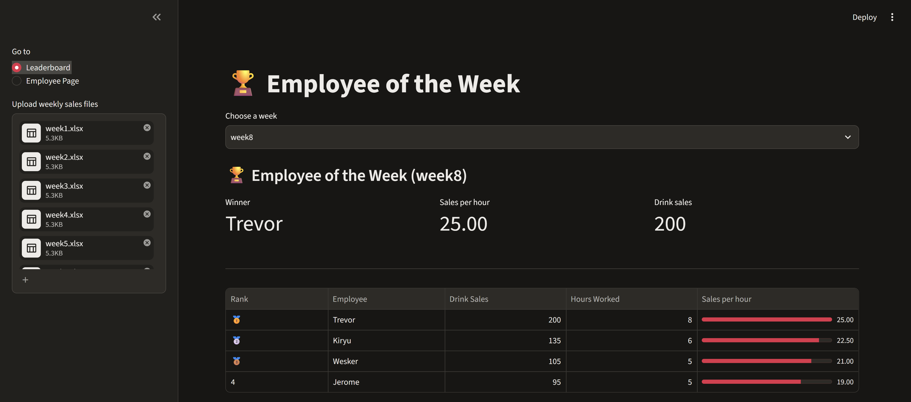
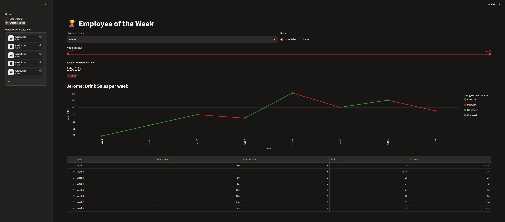

# 🏆 Employee of the Week

A web app that ranks restaurant employees by **drink sales per hour worked**, so managers no longer have to sort the weekly figures by hand.

Built with **Python**, **Streamlit** and **Pandas**.




## The problem

Employees earn a financial incentive for making the most drink sales, which boosts restaurant sales and company profit. But the weekly sales table did not rank employees by their sales-to-hours ratio, so managers had to sort it manually. That takes time and invites human error.

## The solution

Upload the weekly Excel files and the app calculates each employee's ratio, ranks them from highest to lowest, and shows the Employee of the Week on a simple dashboard.

```
Ratio = Drink Sales / Hours Worked
```

## Features

- **Leaderboard**: employees ranked by ratio, with medals for the top three and a bar showing each ratio at a glance
- **Employee of the Week banner**: winner, sales per hour and total drink sales for the chosen week
- **Multiple file upload**: upload several weeks at once; remove a file with the X next to it
- **Previous weeks**: a dropdown to view the leaderboard for any uploaded week
- **Employee page**: a line chart of one employee's drink sales or ratio across the weeks
- **Sliding bar**: choose which range of weeks to display
- **Green / red colouring**: chart lines and the latest value turn green for an increase and red for a decrease compared with the previous week

## How to run it

1. Install [Python](https://www.python.org/downloads/) (3.9 or newer).
2. Download or clone this project and open a terminal in its folder.
3. Install the libraries:

   ```
   pip install -r requirements.txt
   ```

4. Start the app:

   ```
   streamlit run app.py
   ```

5. Your browser opens the app. Upload one or more Excel files in the sidebar.

## Excel file format

Each file covers one week, with **one row per employee** and these columns (spelled exactly like this):

| Employee | Date | Drink Sales | Hours Worked |
|---|---|---|---|
| Kiryu | 2026-11-02 | 120 | 6 |
| Wesker | 2026-11-02 | 90 | 5 |

- The app labels each week using a `Week` column if the file has one. Otherwise it uses the **file name** (for example `week1.xlsx` becomes `week1`).
- Sample files (`week1.xlsx` to `week8.xlsx`) are included for testing.

## Project structure

```
eow_project/
├── app.py             # the Streamlit app
├── requirements.txt   # libraries needed
├── README.md
└── sample_data/       # example weekly Excel files
```

## How it works

1. Each uploaded file is read into a Pandas table and given a week label.
2. All the files are combined into one table and the ratio is calculated for every row.
3. The leaderboard filters the table to the chosen week and sorts it by ratio, highest first.
4. The employee page filters the table to one employee, works out the change from the previous week with `.diff()`, and draws each section of the line in green or red.

## Known limitations

- Week names are sorted as text, so file names like `week10` would appear before `week2`. Using the date or zero-padded names (`week01`, `week02`) avoids this.
- Each file is expected to contain one row per employee.
- Uploaded data is only held while the app is open; nothing is saved between sessions.

## Possible future improvements

- Fix the week sorting so any naming style works
- Handle files where an employee appears more than once
- Save data between sessions with a database
- Add monthly views and team-wide charts

## About this project

This is one of my first Python projects. I am an aspiring junior software developer, and until now my experience has been limited to Python. I built it step by step to learn how to read data with Pandas, build a web interface with Streamlit, and turn a real workplace problem into a working tool.

**Author:** [Vincent Shi] · 
[GitHub link: https://github.com/jeromeDvin] · 
[LinkedIn link: https://www.linkedin.com/in/vincent-shi-426a82215/]
